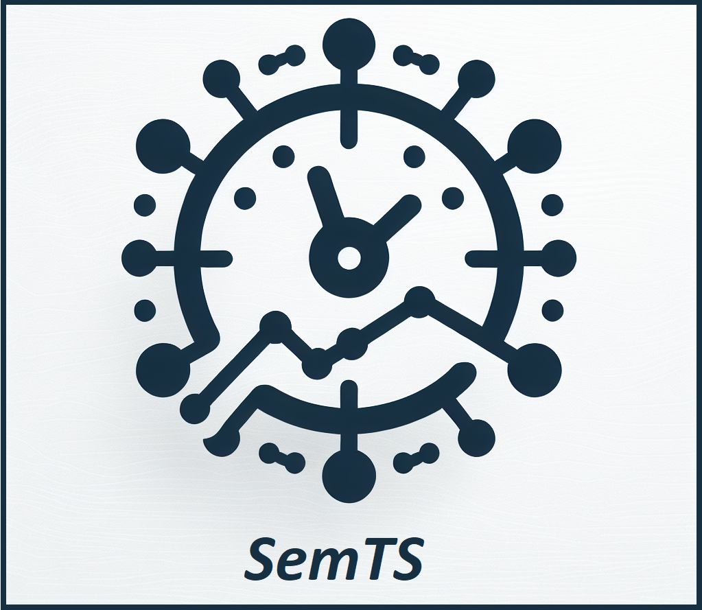
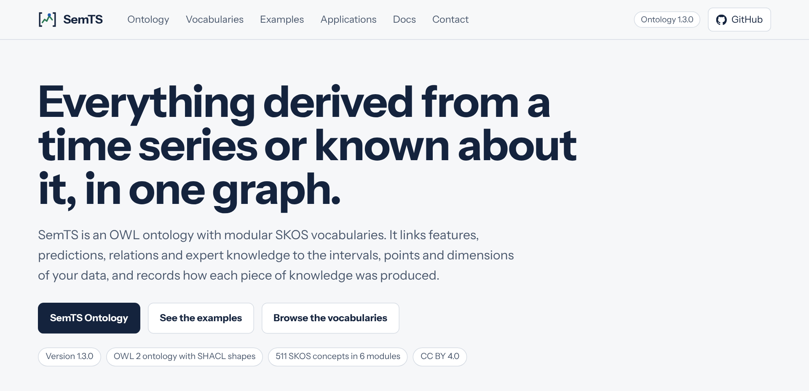
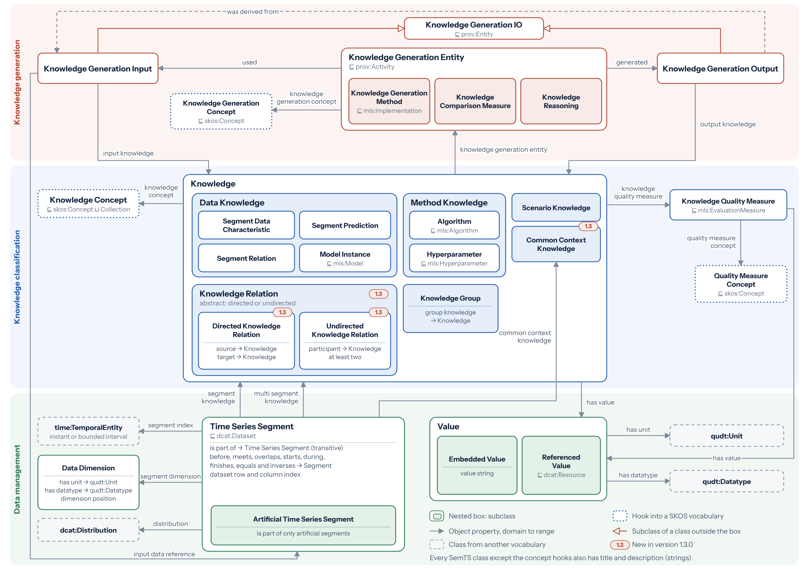

<p align="center">
  
</p>

<h1 align="center">Semantic Time Series Ontology (SemTS)</h1>

<p align="center"><b>Ontology for the Semantic Classification of Time Series Knowledge</b></p>

<p align="center">
  <a href="https://semts-ontology.github.io/SemTS/">Website</a> &nbsp;|&nbsp;
  <a href="https://semts-ontology.github.io/SemTS/#ontology">Ontology</a> &nbsp;|&nbsp;
  <a href="https://semts-ontology.github.io/SemTS/#vocabularies">Vocabularies</a> &nbsp;|&nbsp;
  <a href="https://semts-ontology.github.io/SemTS/#examples">Examples</a> &nbsp;|&nbsp;
  <a href="https://semts-ontology.github.io/SemTS/#reference">Specification</a> &nbsp;|&nbsp;
  <a href="https://semts-ontology.github.io/SemTS/#cite">Cite</a>
</p>

SemTS is an ontology to semantically structure insights gained from multivariate time series analyses combined with domain-specific information. The concept of SemTS constitutes a specification of informative data points or intervals within time series data, further referred to as segments. Any segment comprises characteristic knowledge associated with the covered time interval. Examples of such knowledge range from common time series features and structural particularities, such as anomalies or motifs, to a priori information provided by domain experts. A classification and semantic representation of this knowledge enables organized reusability and effective propagation.

## Documentation

[](https://semts-ontology.github.io/SemTS/)

[semts-ontology.github.io/SemTS](https://semts-ontology.github.io/SemTS/)

## Architecture

[](https://semts-ontology.github.io/SemTS/#ontology)

Version 1.3.0. In the [interactive diagram](https://semts-ontology.github.io/SemTS/#ontology) on the website, select a class or a property to see its definition, axioms and SHACL rules. The diagram of version 1.2.0 is [assets/images/semts.svg](assets/images/semts.svg).

## Namespace and versions

- Prefix: `semts`
- Namespace and ontology IRI: [https://w3id.org/semts/ontology#](https://w3id.org/semts/ontology#)
- Current version (1.3.0): [https://w3id.org/semts/ontology](https://w3id.org/semts/ontology), also `https://w3id.org/semts/ontology/130`
- Earlier versions: `https://w3id.org/semts/ontology/{version}` with `120`, `110`, `101` and `051`

All SemTS identifiers (ontology, vocabularies, shapes) are under [https://w3id.org/semts/](https://w3id.org/semts/). The ontology IRI leads browsers to the documentation and RDF clients to the ontology in RDF/XML, Turtle, JSON-LD or N-Triples.

## Vocabularies

The ontology says what kind of knowledge something is. Six SKOS vocabularies say what it means: core vocabularies for data knowledge, scenario knowledge, knowledge generation (including method knowledge) and quality measures, and two example extensions, a feature catalogue for data knowledge and a manufacturing module for scenario knowledge.

All concepts with their definitions and mappings are in the [vocabulary documentation](https://semts-ontology.github.io/SemTS/#vocabularies).

## Repository

| Path | Content |
|---|---|
| `ontology/current/ontology.ttl` | The ontology, the source of all other serialisations |
| `ontology/versioned/{version}/` | Released versions: WIDOCO documentation up to 1.2.0, a frozen copy of the website from 1.3.0 |
| `vocabularies/` | The vocabulary modules (`.ttl` source, `.owl` generated) |
| `evaluation/instance_validation/` | SHACL shapes |
| `evaluation/competency_questions/` | Competency questions, sample data and the runner |
| `examples/` | The nine examples shown on the website, as Turtle files ([README](examples/README.md)) |
| `application_scenarios/` | Application scenarios from research and industry projects ([scenarios.md](application_scenarios/scenarios.md)) |
| `requirements/` | Requirements derived from interviews and expert discussions, and how SemTS addresses them |
| `site/` | Sources of the website and the vendored WebVOWL ([how the site is built](site/README.md)) |
| `tools/` | Build, validation and source checks |
| `index.html`, `data/` | The website, generated |

## Publications and citation

- [Concept paper (CAiSE 2025 Forum)](https://link.springer.com/chapter/10.1007/978-3-031-94590-8_13)
- [Resource paper (ESWC 2026)](https://link.springer.com/chapter/10.1007/978-3-032-25159-6_10)

Please cite as follows:

```bibtex
@inproceedings{grass2026semts,
  title={SemTS: Ontology and Vocabularies for the Semantic Categorization of Time Series Knowledge},
  author={Gra{\ss}, Alexander and Deshmukh, Rohit A and Lange, Christoph and Collarana, Diego and Beecks, Christian and Decker, Stefan},
  booktitle={European Semantic Web Conference},
  pages={172--190},
  year={2026},
  organization={Springer}
}
```

## Naming conventions

- Directories and files: All small letters, separated by underscores (_). Examples: `ontology.ttl`, `examples/02_segment_knowledge.ttl`. The repository documents `README.md`, `LICENSE.md` and `CHANGELOG.md` keep their usual upper-case names
- Prefixes: In SemTS Ontology, we use https://prefix.cc/ to abbreviate URIs
- Versioning: SemTS releases will follow the Semantic Versioning Specification 2.0.0 (SemVer - Major.Minor.Patch)

## Changelog

- 11/18/26: Version 1.3.0 of the ontology, SHACL shapes and modular vocabularies, with a new website generated from the sources. See [CHANGELOG.md](CHANGELOG.md) and [Changes in 1.3.0](https://semts-ontology.github.io/SemTS/#changes)
- 12/04/25: Updated version (1.2.0). Detailed changes are tracked in the documentation + updated vocabularies
- 08/04/25: Updated version (1.1.0). Detailed changes are tracked in the documentation
- 05/13/25: Updated version (1.0.1). Detailed changes are tracked in the documentation
- 04/25/25: Updated version (0.5.1) of ontology and documentation. First version of vocabularies added
- 02/21/25: New version of ontology UML diagram added
- 02/14/25: Initial version of the documentation added

## License

Ontology files and documentation:<br>
[](https://creativecommons.org/licenses/by/4.0/)

Source code and other software components:<br>
[](https://opensource.org/licenses/Apache-2.0)

[Further details](https://github.com/semts-ontology/SemTS/tree/main?tab=License-1-ov-file#License-1-ov-file)
